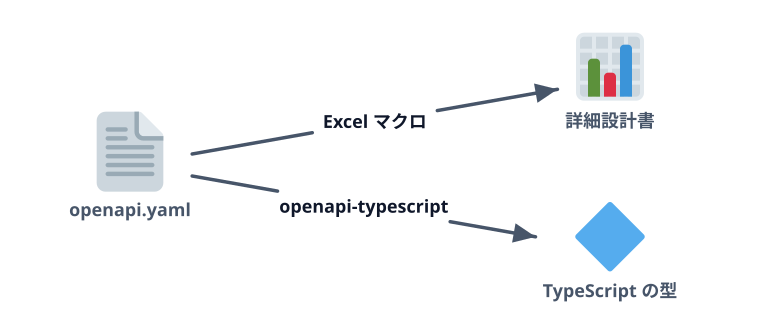
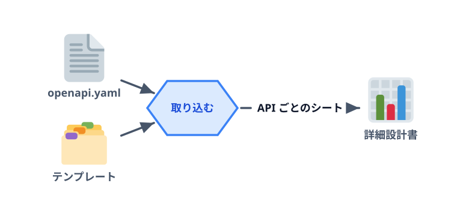
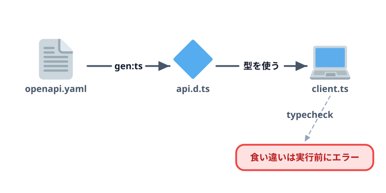

# OpenAPI から詳細設計書を作るハンズオン

API の仕様を **OpenAPI（YAML）1 つ** にまとめ、そこから Excel の詳細設計書と TypeScript の型の両方を作るハンズオンです。設計書・型・コードが同じ 1 つのファイルから作られるので、どれかだけが古くなる、ということが起きにくくなります。

進め方と必要なものは [進め方](./sections/README.md) にあります。

## このハンズオンで作るもの

### 01. 詳細設計書を作る

テンプレートのブック（マクロ入りの Excel）に `openapi.yaml` を取り込み、API ごとに 1 枚ずつシートを作ります。シートには目的・権限・リクエスト・レスポンスが表になって並びます。「処理の内容」だけは人が Excel で書き足す欄で、YAML を直して取り込み直しても消えません。API を足したり消したりしたときに、設計書がどう追従するかも確かめます。題材は JWT で認証するタスク管理 API です。

### 02. TypeScript の型を作る

同じ `openapi.yaml` から、openapi-typescript で TypeScript の型を作ります。その型を openapi-fetch に渡して、YAML どおりかを実行前に確かめられる API クライアントを書きます。最後に YAML を変えて、食い違ったコードが型エラーとして見つかる様子を確かめます。

## リポジトリの構成

| ディレクトリ | 中身 |
|---|---|
| `sections/` | 教材の本文（`LECTURE.md`）と、各節で配るファイル（`example/`） |
| `tool/` | 取り込みマクロの VBA ソースと、テンプレートのブックを組み立てるスクリプト |
| `site/` | この教材のサイト（Starlight） |

取り込みマクロのしくみや、テンプレートの作り直し方は [tool/README.md](./tool/README.md) にあります。

## ドキュメントサイト

<https://seekseep.github.io/openapi-design-doc-handson/>

## 過去のハンズオン

これまでに作ったハンズオンの一覧は [過去のハンズオン](./sections/PAST-HANDSON.md) にあります。
