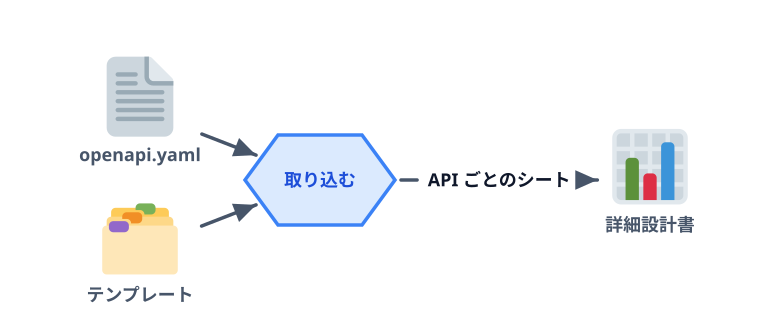
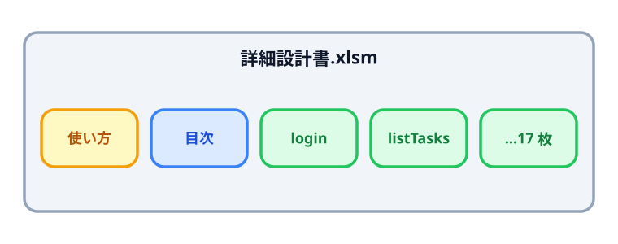

# OpenAPI を取り込んで設計書を作る

まずは動かしてみます。配布する `openapi.yaml`（タスク管理 API の定義）を、テンプレートのブックに取り込みます。ボタンを 1 回押すと、API ごとに 1 枚ずつシートができて詳細設計書になります。

:::download
[openapi.yaml とテンプレートをダウンロード](./project.zip)
:::

ZIP には次の 2 つが入っています。

| ファイル | 中身 |
|---|---|
| `openapi.yaml` | タスク管理 API の定義。JWT で認証する 17 本の API |
| `詳細設計書テンプレート.xlsm` | 取り込みマクロと、シートのひな形が入ったブック |

## ブックを用意する

1. ZIP のブロックを外してから展開します（[Excel の準備](../../00-setup/01-excel/LECTURE.md)）
2. `詳細設計書テンプレート.xlsm` をコピーして、名前を `詳細設計書.xlsm` に変えます

テンプレートは何度でも使い回せるように、元のファイルには取り込まないでおきます。

## 取り込む

1. `詳細設計書.xlsm` を開き、黄色いバーの「コンテンツの有効化」を押します
2. 「使い方」シートの青いボタン **▶ OpenAPI（YAML）を取り込む** を押します
3. ファイルを選ぶ画面で、同じフォルダの `openapi.yaml` を選びます

「取り込みが完了しました。」と出れば成功です。

## できたものを見る

### 目次

「目次」シートに、YAML に書いた順で API が並びます。operationId の文字はリンクになっていて、押すとその API のシートに移ります。各シートの左上の「← 目次へ戻る」で戻れます。

### API のシート

`login` のシートを開いてみます。上から次の順に並んでいます。

| 見出し | 書いてあること |
|---|---|
| ■ 基本情報 | operationId、メソッド、パス、タグ、概要 |
| ■ 目的 | この API が何のためにあるか |
| ■ 権限 | 認証方式（JWT かどうか）と、呼べるロール |
| ■ リクエスト | パラメータとボディの項目の表 |
| ■ レスポンス | ステータスコードごとのヘッダーとボディの項目の表 |
| ■ 処理の内容 | 処理の流れ。ここだけは人が書く欄 |

`listTasks` や `createTask` も開いて、表の行数が API ごとに違うことを確かめてください。パラメータが多い API は行が多く、ボディが無い API は「なし」になっています。

### backup フォルダ

ブックと同じフォルダに `backup` フォルダができています。取り込むたびに、取り込む直前のブックのコピーがここに保存されます。取り込みで困ったことが起きても、ここから戻せます。

::codeview[配布した openapi.yaml]

:::faq

### ボタンを押しても何も起きない

マクロが無効になっています。ブックを開き直して「コンテンツの有効化」を押してください。赤いバーが出ている場合は、ZIP のブロックが外れていません（[Excel の準備](../../00-setup/01-excel/LECTURE.md)）。

### 「YAML line 123: ...」というエラーが出た

YAML の 123 行目が読めませんでした。インデント（字下げ）のずれや、閉じていない引用符がよくある原因です。このマクロが読める YAML には制限があり、アンカー（`&` / `*`）と、別ファイルを指す `$ref` には対応していません。

### シートが多すぎて目的の API が見つからない

目次から移るのが早いです。シートの見出しの左端にある矢印を右クリックすると、シートの一覧から選ぶこともできます。

:::
