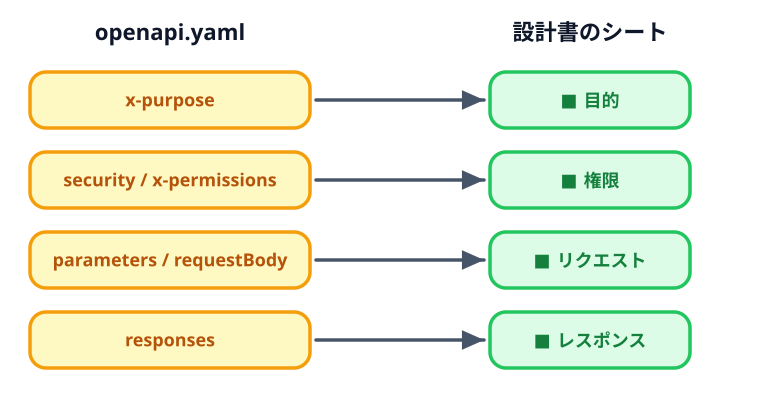

# YAML と設計書の対応を読む



前の節で作った設計書と `openapi.yaml` を見比べて、YAML のどこが設計書のどこになるかを確かめます。YAML の書き方が分かれば、自分の API の設計書も同じように作れます。

この節で使うファイルは前の節と同じです。

## 1 つの API を見比べる

`updateTask`（タスク更新）を例にします。`openapi.yaml` の該当部分はこうなっています（一部省略）。

```yaml
  /tasks/{taskId}:
    parameters:
      - $ref: '#/components/parameters/TaskId'
    patch:
      operationId: updateTask
      tags: [tasks]
      summary: タスク更新
      x-purpose: 担当者がタスクの状態や期限を変更する。送った項目だけを更新する。
      x-permissions:
        - role: member
          condition: 自分が担当のタスクのみ
        - role: admin
          condition: すべてのタスク
      x-processing:
        - step: 入力チェック
          detail: title は 1〜100 文字。dueDate に null を送ると期限を消す
      requestBody:
        required: true
        content:
          application/merge-patch+json:
            schema:
              $ref: '#/components/schemas/TaskPatch'
      responses:
        '200':
          description: 更新成功
        '404':
          $ref: '#/components/responses/NotFound'
```

設計書の `updateTask` シートと並べると、次のように対応しています。

| 設計書の欄 | YAML の場所 |
|---|---|
| シートのキー・シート名 | `operationId` |
| 基本情報のメソッド・パス | `paths` のキー（`/tasks/{taskId}`）と、その下のキー（`patch`） |
| 概要 | `summary` |
| 目的 | `x-purpose`（無ければ `description`） |
| 権限の「認証」 | `security`（無ければファイル先頭の `security`） |
| 権限の「ロール・条件」 | `x-permissions` |
| リクエストのパラメータ | `parameters`（パスの下に書いたものと、メソッドの下に書いたものを合わせる） |
| リクエストのボディ | `requestBody` |
| レスポンス | `responses` |
| 処理の内容 | `x-processing`（最初の 1 回だけ。次の節で説明） |

`x-` で始まる 3 つ（`x-purpose`、`x-permissions`、`x-processing`）は、OpenAPI の仕様には無い **拡張フィールド** です。OpenAPI は `x-` で始まる名前なら自由に足してよいことになっていて、ほかのツールは無視します。設計書にだけ載せたい情報をここに書いています。

## 認証（JWT）

ファイルの先頭で、すべての API に JWT を求めています。

```yaml
security:
  - bearerAuth: []

components:
  securitySchemes:
    bearerAuth:
      type: http
      scheme: bearer
      bearerFormat: JWT
```

設計書の「認証」欄には `bearerAuth: HTTP bearer (JWT)` と出ます。ログインのように認証が要らない API は、メソッドの下で `security: []` と上書きしていて、「認証なし」と出ます。

## $ref は展開される

`$ref: '#/components/schemas/TaskPatch'` のように、同じファイルの別の場所を指している部分は、指している先の中身を展開して表にします。共通のレスポンス（`#/components/responses/NotFound`）や共通のパラメータ（`#/components/parameters/TaskId`）も同じです。

## 入れ子の項目の名前

ボディの項目が入れ子になっているときは、項目名を次の形で 1 行ずつに広げます。

| 書き方 | 意味 | 例 |
|---|---|---|
| `a.b` | オブジェクト `a` の中の `b` | `assignee.name` |
| `a[]` | 配列 `a` の要素 | `checklist[]` |
| `a[].b` | 配列 `a` の要素の中の `b` | `checklist[].text` |
| `{key}` | キーが自由なオブジェクトの値 | `Labels` の `{key}` |
| `（ボディ全体）` | ボディそのものが配列や文字列のとき | ファイルのダウンロード |

`listActivities` のように「いくつかの形のどれか」になるボディ（`oneOf`）は、候補ごとに `<CommentActivity>` のような行を挟んで並べます。`getCategoryTree` のカテゴリのように、自分自身を子に持つ型は、2 段目で展開を止めて「再帰」と書きます。

## 型と制約の欄

| 欄 | 中身 |
|---|---|
| 型 | `string`、`integer` など。`format` があれば `string(uuid)` のように添える。名前の付いた型（`$ref`）は `TaskStatus : string` や `UserSummary` |
| 必須 | `required` に名前があれば ○ |
| 制約 | `enum`、`minLength`、`maximum`、`pattern`、`default`、`nullable`、`readOnly` など |

いくつかシートを開いて、YAML の書き方と見比べてみてください。

:::faq

### operationId を書き忘れた API はどうなる

メソッドとパスから `patch_tasks__taskId_` のような名前を作ってシート名にします。シートと API を結び付けるキーになるので、operationId は書いておくのがおすすめです。

### 別ファイルに分けた YAML（`$ref: './schemas/task.yaml'`）は読める？

読めません。1 つのファイルにまとめてから取り込んでください。`npx @redocly/cli bundle` などのツールで 1 ファイルにできます。

:::
