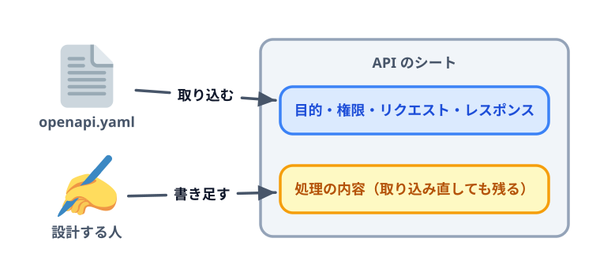
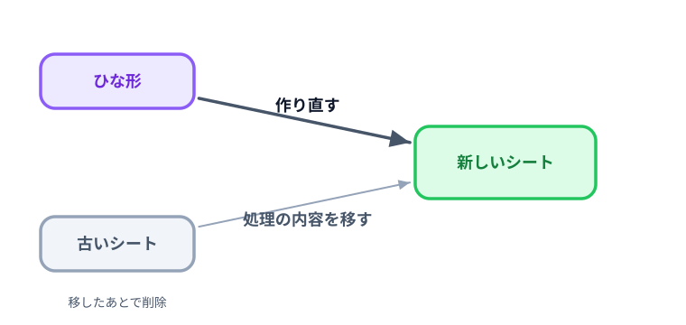

# 処理の内容を書き足す



OpenAPI に書けるのは、API の「外から見た形」です。中でどう処理するかは、設計書の「■ 処理の内容」に Excel で書きます。この欄は、YAML を取り込み直しても消えません。

この節で使うファイルは、前の節までと同じです。

## 処理の内容を書く

`createTask` のシートを開き、一番下の「■ 処理の内容」までスクロールします。空の行が 5 行あります。次のように書いてみます。

| No | 処理 | 詳細 | 備考 |
|---|---|---|---|
| 1 | 入力チェック | title は 1〜100 文字。projectId が存在するか確認する | |
| 2 | 権限チェック | member の場合、JWT の sub のユーザーがプロジェクトに所属しているか確認する | |
| 3 | 登録 | status の既定値は todo。createdAt / updatedAt を現在時刻にする | |
| 4 | 応答 | 201 と Location ヘッダーを返す | |

行が足りないときは、表の途中の行を選んで右クリック →「挿入」で増やせます。表の **中に** 挿入してください（理由は後で説明します）。

## YAML から最初の中身を入れる

`updateTask` のシートを開くと、処理の内容が最初から 4 行入っています。YAML の `x-processing` に書いた内容です。

```yaml
      x-processing:
        - step: 入力チェック
          detail: title は 1〜100 文字。dueDate に null を送ると期限を消す
        - step: 権限チェック
          detail: member の場合、assigneeId が JWT の sub と一致するか確認する
```

`x-processing` は **その API の処理の内容が空のときだけ** 使われます。いったん Excel に何か書いたら、そこから先は Excel の内容が正です。API を作る人が YAML にあらすじを書き、設計する人が Excel で詳しくする、という分担ができます。

## 取り込み直しても残ることを確かめる

1. ブックを保存します
2. 「使い方」シートのボタンを押し、同じ `openapi.yaml` をもう一度選びます
3. `createTask` のシートを開きます

書いた 4 行がそのまま残っています。シートそのものは作り直されていて、処理の内容だけが新しいシートに移されています。



:::warning[処理の内容の外に書いたものは消えます]
「■ 目的」の下にメモを書いたり、表の色を変えたりしても、取り込み直すと元に戻ります。設計書の正は YAML なので、目的や項目の説明を直したいときは YAML を直して取り込み直してください。
:::

## しくみ：見えない 2 行で挟んでいる

「■ 処理の内容」の表は、上下を **非表示の行** で挟んでいます。取り込み直すときは、その 2 行の間にある行を、書式や行の高さごと新しいシートに移します。

表の外（いちばん下の行のさらに下など）に行を足すと、挟んでいる範囲の外に出てしまい、取り込み直したときに消えます。行は表の **中に** 挿入してください。

:::faq

### 処理の内容を全部消したらどうなる

処理の内容が空のシートとして扱われます。次に取り込んだとき、YAML に `x-processing` があればその内容が入り、無ければ空の 5 行に戻ります。

### operationId を変えたら処理の内容はどうなる

別の API として扱われます。新しい operationId のシートが作られ、古いシートは目次で「廃止」と表示されて残ります（次の節で扱います）。古いシートから処理の内容をコピーして移してください。

:::
