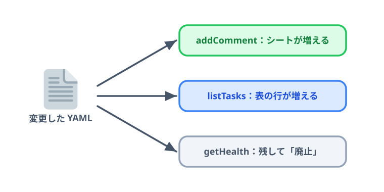
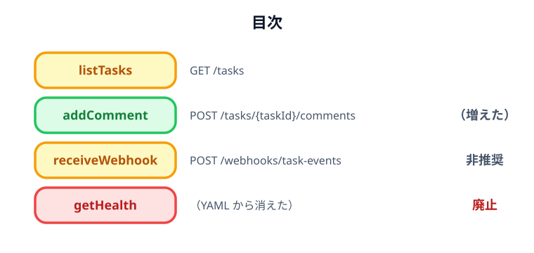

# API を変えて取り込み直す



API の設計は途中で何度も変わります。YAML を直して取り込み直すと、設計書がどう追従するかを確かめます。次の 3 つの変更を入れます。

| 変更 | 対象 | 設計書で起きること |
|---|---|---|
| パラメータを足す | `listTasks` に `priority` | パラメータの表の行が 1 行増える |
| API を足す | `addComment`（コメント追加） | シートが 1 枚増える |
| API を消す | `getHealth`（死活監視） | シートは残り、目次で「廃止」になる |

## YAML を直す

前の節で使った `openapi.yaml` をエディタ（メモ帳でも可）で開き、次の 3 か所を直します。手で直すのが面倒なら、変更済みの YAML を下からダウンロードして差し替えても構いません。

:::download
[変更済みの openapi.yaml をダウンロード](./project.zip)
:::

### 1. listTasks にパラメータを足す

`listTasks` の `parameters` の中、`assigneeId` の前に足します。

```yaml
        - name: priority
          in: query
          description: 優先度で絞り込む
          schema:
            $ref: '#/components/schemas/Priority'
```

### 2. コメント追加の API を足す

`/tasks/{taskId}/attachments:` の行の **前** に、パスを 1 つ足します。インデント（行頭の空白）は `/tasks/{taskId}/attachments:` とそろえます。

```yaml
  /tasks/{taskId}/comments:
    parameters:
      - $ref: '#/components/parameters/TaskId'
    post:
      operationId: addComment
      tags: [tasks]
      summary: コメント追加
      x-purpose: タスクにコメントを書き込む。書き込んだコメントは履歴に残る。
      x-permissions:
        - role: member
          condition: 自分が所属するプロジェクトのタスクのみ
        - role: admin
      requestBody:
        required: true
        content:
          application/json:
            schema:
              type: object
              required:
                - body
              properties:
                body:
                  type: string
                  minLength: 1
                  maxLength: 1000
                  description: コメント本文
      responses:
        '201':
          description: 追加成功
          content:
            application/json:
              schema:
                $ref: '#/components/schemas/CommentActivity'
        '401':
          $ref: '#/components/responses/Unauthorized'
        '404':
          $ref: '#/components/responses/NotFound'
        '422':
          $ref: '#/components/responses/ValidationFailed'
```

### 3. 死活監視の API を消す

`/health:` から、その下の `getHealth` の定義の終わり（`components:` の直前）までを消します。

## 取り込み直す

1. `詳細設計書.xlsm` を開き、「使い方」シートのボタンを押して、直した `openapi.yaml` を選びます
2. 「目次」を開きます



確かめるところは 4 つです。

- **増えた API**：目次に `addComment` が増え、シートができている
- **変わった API**：`listTasks` のパラメータの表に `priority` の行が増えている。下の表がその分ずれても崩れていない
- **消えた API**：`getHealth` のシートは消えずに残り、シート見出しが灰色、目次の状態が「廃止」になっている
- **処理の内容**：前の節で `createTask` に書いた処理の内容が残っている

## 消えた API のシートを残す理由

YAML から API を消しても、シートは自動では消しません。そのシートの「処理の内容」に、人が書いた内容があるかもしれないからです。内容を確かめ、要らなければシートを手で削除してください。削除したシートは、次の取り込みからは目次にも出ません。

## 行数が変わっても崩れないしくみ

パラメータやレスポンスの数は API ごとに違い、YAML を直すたびに変わります。そのため設計書は、毎回ひな形のシートから作り直しています。ひな形には「この行を項目の数だけ繰り返す」という目印の行が非表示で入っていて、取り込むときに必要な数だけ行を複製します。目印の詳しい話は「テンプレートの見た目を変える」で扱います。

::codeview[変更後の openapi.yaml]

:::faq

### YAML を直したのにエラーになる

インデントのずれが一番多い原因です。エラーに出た行番号の前後で、行頭の空白の数が周りとそろっているか確かめてください。VS Code で開くと、ずれている場所に印が付きます。

### 間違えて取り込んでしまった

ブックと同じフォルダの `backup` に、取り込む直前のブックが日時付きで保存されています。今のブックを閉じ、backup のファイルをコピーして使ってください。

:::
