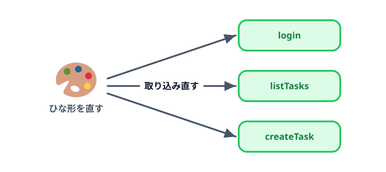

# テンプレートの見た目を変える

設計書の見た目（見出しの文言、色、列の幅、欄の並び）は、ブックの中の **ひな形のシート** で決まっています。ひな形を直してから取り込み直すと、すべての API のシートが新しい見た目で作り直されます。マクロのコードを触る必要はありません。

## ひな形のシートを表示する

ひな形は非表示になっています。

1. どれかのシート見出しを右クリック →「再表示」
2. `_tpl_endpoint` を選んで「OK」

| シート | 役割 |
|---|---|
| `_tpl_endpoint` | API ごとのシートのひな形 |
| `_tpl_index` | 目次のひな形 |
| `_config` | 「○」「認証なし」などの表示文字と設定 |

## 見た目を変えてみる

`_tpl_endpoint` で次のように変えてみます。

1. 「■ 目的」のセルを「■ この API の目的」に書き換える
2. 「■ 基本情報」の行の塗りつぶしの色を好きな色に変える
3. G 列（説明）の幅を広げる

保存してから「使い方」シートのボタンで取り込み直すと、すべての API のシートが変わります。処理の内容はこれまでどおり残ります。

終わったら、`_tpl_endpoint` の見出しを右クリック →「非表示」で隠しておきます。

## 目印のしくみ

ひな形の **A 列** は非表示の列で、行ごとの「目印」が書いてあります。A 列の幅を広げると見えます。

| A 列の目印 | 意味 |
|---|---|
| （空） | そのまま使う行 |
| `@row:params` | パラメータの数だけこの行を繰り返す |
| `@empty:params` | パラメータが 1 つも無いときだけ残す行（「なし」） |
| `@if:deprecated` | 非推奨の API のときだけ残す行 |
| `@block:responses` 〜 `@end:responses` | 間の行を、レスポンスの数だけ繰り返す |
| `@section:headers` 〜 `@end:headers` | レスポンスヘッダーがあるときだけ、間の行を残す |
| `@processing:begin` 〜 `@processing:end` | この間が「処理の内容」。取り込み直しても移される |
| `opid:{{operationId}}`（A1） | シートと API を結び付けるキー |

セルの中の `{{summary}}` のような部分は、取り込むときに YAML の値に置き換わります。

| 書ける値 | 中身 |
|---|---|
| `{{operationId}}` `{{method}}` `{{path}}` `{{tags}}` `{{summary}}` | 基本情報 |
| `{{purpose}}` `{{description}}` `{{auth}}` `{{deprecated}}` | 目的・説明・認証・非推奨 |
| `{{name}}` `{{in}}` `{{type}}` `{{required}}` `{{constraints}}` `{{description}}` `{{example}}` | 表の 1 行（パラメータ・ボディの項目・ヘッダー） |
| `{{role}}` `{{condition}}` | 権限の 1 行 |
| `{{status}}` `{{statusDescription}}` `{{contentType}}` | レスポンス・ボディの見出し |

たとえば基本情報に「説明」の行を足したいときは、「概要」の行をコピーして下に挿入し、C 列を「説明」、D 列を `{{description}}` にします。

:::warning[A 列の目印は消さない]
目印を消したり、`@block:` と `@end:` の片方だけを消したりすると、取り込みがエラーになったり表が崩れたりします。行を足すときは、目印の無い行として足してください。
:::

:::faq

### 元の見た目に戻したい

配布した `詳細設計書テンプレート.xlsm` の `_tpl_endpoint` シートを、今のブックにコピーして差し替えてください（シート見出しを右クリック →「移動またはコピー」）。差し替えたら名前を `_tpl_endpoint` にそろえます。

### 「○」や「認証なし」の文字を変えたい

`_config` シートの B 列を書き換えます。A 列（キー）は変えないでください。

:::
