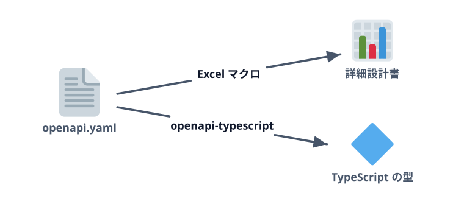

# OpenAPI から型を作る



第 1 章では `openapi.yaml` から詳細設計書を作りました。同じ YAML から、今度はプログラムで使う **TypeScript の型** を作ります。設計書とコードが同じ 1 つのファイルから作られるので、どちらかだけが古くなる、ということが起きにくくなります。

型は [openapi-typescript](https://openapi-ts.dev/) で作ります。Node.js が必要です（[Node.js の準備](../../00-setup/02-node/LECTURE.md)）。

:::download
[プロジェクトをダウンロード](./project.zip)
:::

| ファイル | 中身 |
|---|---|
| `openapi.yaml` | 第 1 章の最後（API を変えたあと）の YAML |
| `package.json` | 使うパッケージと、型を作るコマンド（`gen:ts`） |
| `tsconfig.json` | TypeScript の設定 |
| `src/generated/api.d.ts` | 作った型（自分で作り直すので、無くても構いません） |

## 型を作る

展開したフォルダを VS Code で開き、ターミナルで次を実行します。

```powershell
npm install
npm run gen:ts
```

`🚀 openapi.yaml → src/generated/api.d.ts` と出れば成功です。`package.json` の `gen:ts` には、次のコマンドが書いてあります。

```json
"gen:ts": "openapi-typescript openapi.yaml -o src/generated/api.d.ts"
```

## できた型を読む

`src/generated/api.d.ts` を開きます。大きく 3 つの型があります。

| 型 | 中身 |
|---|---|
| `paths` | パスとメソッドごとの、パラメータ・ボディ・レスポンス |
| `components` | `components` に書いた共通の型（`schemas` など） |
| `operations` | operationId ごとの、パラメータ・ボディ・レスポンス |

たとえば `components["schemas"]["TaskPatch"]` はこうなっています。

```ts
TaskPatch: {
    title?: string;
    status?: components["schemas"]["TaskStatus"];
    priority?: components["schemas"]["Priority"];
    /**
     * Format: date
     * @description null を送ると期限を消す
     */
    dueDate?: string | null;
    /**
     * Format: uuid
     * @description null を送ると担当を外す
     */
    assigneeId?: string | null;
};
```

設計書の `updateTask` のボディの表と見比べてください。

- 必須でない項目は `?` が付いている（設計書では「必須」が空欄）
- `nullable: true` の項目は `| null` になっている（設計書では制約に `nullable`）
- `TaskStatus` は `"todo" | "doing" | "done"` のどれか、という型になっている（設計書では制約に `enum`）

設計書と型が、同じ YAML の同じ記述から作られていることが分かります。

## YAML を直したら作り直す

YAML を直したら `npm run gen:ts` をもう一度実行します。`api.d.ts` は毎回まるごと作り直されるので、このファイルは手で直さないでください。

::codeview[このステップのプロジェクト]{defaultFile="package.json"}

:::faq

### `openapi-typescript` が見つからないと言われる

`npm install` をまだ実行していません。`package.json` があるフォルダで `npm install` を実行してから、もう一度試してください。

### TypeScript 7 を使いたい

この教材の時点では openapi-typescript が TypeScript 5 系を前提にしているため、`package.json` では 5 系を指定しています。

:::
