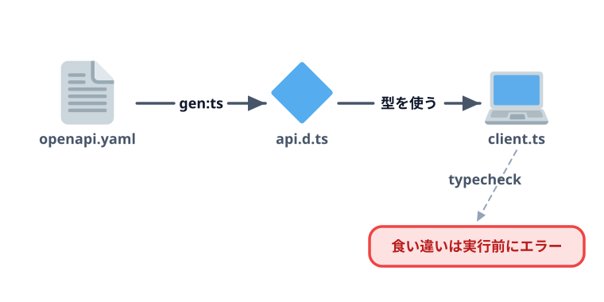

# 型を使って API を呼ぶ



前の節で作った型を使って、API を呼ぶコードを書きます。[openapi-fetch](https://openapi-ts.dev/openapi-fetch/) を使うと、パス・パラメータ・ボディ・レスポンスがすべて YAML どおりかを、TypeScript が実行前に確かめてくれます。最後に YAML を変えて、食い違ったコードが見つかる様子を確かめます。

:::download
[プロジェクトをダウンロード](./project.zip)
:::

前の節のプロジェクトに、次のファイルが増えています。

| ファイル | 中身 |
|---|---|
| `src/client.ts` | 型付きのクライアントと、それを使った API の呼び出し |
| `package.json` | `openapi-fetch` と、型を確かめるコマンド（`typecheck`）を追加 |

## 型を確かめる

```powershell
npm install
npm run gen:ts
npm run typecheck
```

`typecheck` は `tsc --noEmit` です。コードを実行せず、型が合っているかだけを確かめます。何も表示されずに終われば、コードは YAML と食い違っていません。

## コードを読む

`src/client.ts` の要点を見ます。

### クライアントを作る

```ts
import createClient from "openapi-fetch";
import type { paths } from "./generated/api";

const client = createClient<paths>({ baseUrl: "http://localhost:3000/v1" });
```

`createClient` に前の節で作った `paths` 型を渡すだけで、型付きのクライアントになります。

### JWT を付ける

ログインで受け取ったアクセストークン（JWT）を、すべてのリクエストの `Authorization` ヘッダーに付けます。

```ts
const authMiddleware: Middleware = {
  onRequest({ request }) {
    if (tokens) {
      request.headers.set("Authorization", `Bearer ${tokens.accessToken}`);
    }
    return request;
  },
};
client.use(authMiddleware);
```

`tokens` の型は `components["schemas"]["TokenPair"]` です。`accessToken` を `acessToken` と打ち間違えると、`typecheck` でエラーになります。

### API を呼ぶ

```ts
const { data, error } = await client.GET("/tasks", {
  params: {
    query: { status: ["todo", "doing"], assigneeId, sort: "dueDate", perPage: 50 },
  },
});
```

`"/tasks"` は YAML にあるパスしか書けません。`query` に書ける名前と値も YAML どおりで、たとえば `sort: "title"` と書くと、`enum` に無い値としてエラーになります。`data` は 200 のときのレスポンスの型（`TaskPage`）、`error` はエラーのときの型（`Problem`）になります。

## YAML を変えて、食い違いを見つける

API の設計が変わったときに、型がどう助けてくれるかを確かめます。

1. `openapi.yaml` の `TaskInput` で、`title` を `name` に変えます（`required` の中の `title` も）
2. `npm run gen:ts` で型を作り直します
3. `npm run typecheck` を実行します

`client.ts` の `listMyTodoTitles` がタスクの `title` を使っているので、次のようなエラーになります。

```text
src/client.ts(58,38): error TS2339: Property 'title' does not exist on type '{ name: string; ...
```

`Task` は `allOf` で `TaskInput` を含んでいるので、`TaskInput` の変更が `Task` を使うコードにも伝わります。API を実際に呼ぶ前に、直すべき場所が行番号付きで分かります。

確かめたら、YAML を元に戻して `npm run gen:ts` をやり直します。

設計書を作り直すのと同じ手順（YAML を直す → 作り直す）で、コードの食い違いも見つかります。設計書・型・コードの 3 つが、1 つの YAML でつながりました。

::codeview[このステップのプロジェクト]{defaultFile="src/client.ts"}

:::faq

### このコードは実際に API を呼べる？

`http://localhost:3000/v1` で API が動いていれば呼べますが、この教材では API のサーバーは用意していません。型が合っているかを `typecheck` で確かめるところまでが範囲です。

### Content-Type を指定しているのはなぜ

`updateTask` のボディは YAML で `application/merge-patch+json` と決めています。openapi-fetch の既定は `application/json` なので、YAML に合わせて指定しています。

:::
