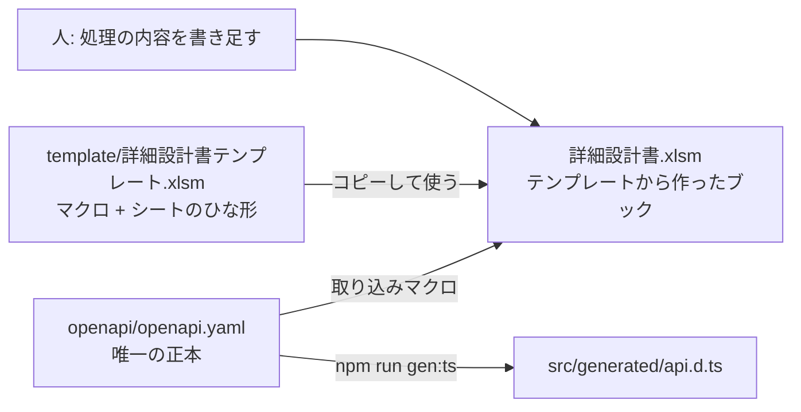

# 設計: OpenAPI から詳細設計書（Excel）と TypeScript を生成する

> 実装を始める前に書いた設計メモです。ディレクトリ構成やファイル名はその後変わっています（`template/` → `tool/`、利用環境は Windows の Excel を前提に変更）。現在の構成は [README.md](./README.md) を見てください。

## 1. ゴール

- `openapi.yaml` を唯一の正本にし、そこから次の 2 つを生成する。
  - `openapi -> xlsx`: エンドポイントごとに 1 シートの詳細設計書
  - `openapi -> typescript`: API の型（とクライアント）
- Excel は **テンプレートのブック** を用意し、そこへマクロで YAML を取り込むと設計書ができあがる。
- 取り込み直すと、既存のエンドポイントのシートは **上書き** される。
- **処理の内容だけは Excel に書き足せる**。上書きしても消えない。それ以外（目的・権限・リクエスト・レスポンス）は YAML が正本で、Excel で直しても次の取り込みで戻る。
- 本番の利用環境は Windows。当面は macOS（Excel for Mac）で動作確認する。

## 2. 全体像



| 変換 | 実行手段 | 必要なもの |
| --- | --- | --- |
| openapi → xlsx | テンプレートのブックに入ったマクロ（純 VBA で YAML を読む） | Excel のみ |
| openapi → TypeScript | `npm run gen:ts` | Node.js |

### 使い方の流れ

1. `詳細設計書テンプレート.xlsm` をコピーして、`詳細設計書.xlsm` などの名前で保存する。
2. 開いて「OpenAPI を取り込む」ボタンを押し、`openapi.yaml` を選ぶ。
3. エンドポイントごとのシートと目次ができる。
4. 各シートの「処理の内容」に書き足す。
5. YAML を直したら、同じブックで 2. をもう一度行う。シートは上書きされ、処理の内容は残る。

### なぜ純 VBA で YAML を読むか

- Windows の業務 PC では Node を入れられないことが多い。Excel だけで完結させたい。
- Mac の VBA は `Shell` がサンドボックスで制限されるため、マクロから Node を呼ぶ方式は Mac で動かしにくい。純 VBA なら Win / Mac で同じコードが動く。

## 3. OpenAPI 側の書き方（規約）

| 設計書の項目 | OpenAPI の参照先 |
| --- | --- |
| シートのキー | `operationId`（必須） |
| 概要 | `summary` |
| 目的 | `x-purpose`（なければ `description`） |
| 権限 | `security`（認証方式とスコープ）＋ `x-permissions`（ロールと条件） |
| リクエスト | `parameters`（path / query / header / cookie）＋ `requestBody` |
| レスポンス | `responses`（ステータスコードごと。ヘッダーも含む） |
| 処理の内容 | 任意で `x-processing`。シートの処理の内容が空のときだけ初期値として使う |

```yaml
paths:
  /tasks/{taskId}:
    patch:
      operationId: updateTask
      summary: タスク更新
      x-purpose: 担当者がタスクの状態や期限を変更する。
      security: [{ bearerAuth: [] }]
      x-permissions:
        - role: member
          condition: 自分が担当のタスクのみ
        - role: admin
          condition: すべてのタスク
      x-processing:               # 任意
        - step: 入力チェック
          detail: title は 1〜100 文字
      parameters: [...]
      requestBody: {...}
      responses: {...}
```

## 4. テンプレートのブック

### 4.1 シート

| シート | 表示 | 役割 |
| --- | --- | --- |
| `使い方` | 表示 | 「OpenAPI を取り込む」ボタンと手順 |
| `目次` | 表示 | 全エンドポイントの一覧。取り込むたびに作り直す |
| `<operationId>` | 表示 | エンドポイント 1 件の詳細。取り込むたびに作る / 上書きする |
| `_tpl_endpoint` | 非表示 | エンドポイントシートのひな形 |
| `_tpl_index` | 非表示 | 目次のひな形 |
| `_config` | 非表示 | 前回の YAML のパス、取り込み日時、テンプレートの版 |

見た目（列幅、フォント、罫線、色、見出しの文言）は **ひな形のシートで決める**。マクロは位置と書式を知らず、目印を探して値を入れるだけにする。利用者はひな形を Excel で直すだけで設計書の見た目を変えられる。日本語の見出しもひな形にあるので、VBA のコードに日本語を書かずに済む（6 章）。

### 4.2 ひな形の目印

ひな形の **A 列を非表示の「目印列」** にする。行の役割を A 列に書いておき、マクロは A 列を上から読んで行を探す。行が増減しても目印は行と一緒に動くので、位置がずれても壊れない。

| A 列の目印 | 行の種類 | マクロの動き |
| --- | --- | --- |
| （空） | 固定の行（見出し、表のヘッダーなど） | そのまま。セル内の `{{...}}` は値に置き換える |
| `@row:params` | 明細行のひな形（**非表示**） | 件数分コピーして表示し、`{{name}}` などを埋める。ひな形の行は消す |
| `@row:body` | 同上（リクエストボディの項目） | 同上 |
| `@row:permissions` | 同上（ロールと条件） | 同上 |
| `@block:response` 〜 `@end:response` | 繰り返すブロック（ステータスコードごと） | ブロックをレスポンスの数だけコピーし、中の `@row:resheaders` / `@row:resbody` を埋める |
| `@empty:params` など | 「なし」と書いた行（**非表示**） | 件数が 0 のときだけ表示する |
| `@processing:begin` | 処理の内容の開始（**非表示**） | この行と `@processing:end` の間が人の書く領域 |
| `@processing:end` | 処理の内容の終わり（**非表示**） | 同上 |

置き換える値（`{{...}}`）:

- 単一の値: `{{operationId}}` `{{method}}` `{{path}}` `{{tags}}` `{{summary}}` `{{purpose}}` `{{auth}}` `{{deprecated}}` `{{contentType}}`
- 明細行の中: `{{name}}` `{{in}}` `{{type}}` `{{required}}` `{{constraints}}` `{{description}}` `{{example}}` `{{role}}` `{{condition}}`
- レスポンスのブロックの中: `{{status}}` `{{statusDescription}}` `{{contentType}}`

### 4.3 エンドポイントシートの見え方

```
（A列は非表示）
■ 基本情報
  operationId | updateTask
  メソッド    | PATCH
  パス        | /tasks/{taskId}
  概要        | タスク更新
■ 目的
  担当者がタスクの状態や期限を変更する。
■ 権限
  認証方式 | bearerAuth
  ロール   | 条件
  member   | 自分が担当のタスクのみ        ← @row:permissions を 2 件分コピー
  admin    | すべてのタスク
■ リクエスト
  ▼ パラメータ
  名前 | 位置 | 型 | 必須 | 説明 | 例
  taskId | path | string | ○ | ...        ← @row:params
  ▼ ボディ（application/json）
  項目 | 型 | 必須 | 制約 | 説明 | 例
  title | string | | maxLength: 100 | ...   ← @row:body
■ レスポンス
  ▼ 200 成功                             ← @block:response 1 つ目
  項目 | 型 | 必須 | 制約 | 説明 | 例
  ...
  ▼ 404 タスクが存在しない                 ← @block:response 2 つ目
  （ボディなし）
■ 処理の内容
  No | 処理 | 詳細 | 備考
  （非表示: @processing:begin）
  1 | 入力チェック | ... |                 ← 人が書く。行は自由に足せる
  2 | 権限チェック | ... |
  （非表示: @processing:end）
```

スキーマを表に出すときの規則:

- ネストしたオブジェクトは `a.b`、配列は `items[]` の形で 1 行ずつ平坦化する。
- `$ref` は展開する。循環参照は 2 回目で展開を止め、`→ Category（再帰）` と書く。
- `allOf` はマージする。`oneOf` / `anyOf` は「いずれか」として候補ごとに見出しを付けて並べ、`discriminator` があれば判別キーと値を書く。
- `enum` / `minLength` / `maximum` / `pattern` / `format` / `default` / `nullable` / `readOnly` / `writeOnly` は「制約」列にまとめる。
- `additionalProperties` は `{キー}` という行で表す。
- `multipart/form-data` などボディの Content-Type が複数あるときは、Content-Type ごとに表を分ける。

処理の内容を非表示の 2 行で挟むのは、人が行を足したり消したりしても領域の範囲が分かるようにするため。2 行の間に行を挿入すれば、`@processing:end` は自動で下にずれる。

## 5. 取り込み（上書き）の動き

上書きは「ひな形から作り直し、処理の内容だけ移植する」方式にする。既存のシートの中身を部分的に直す方式（その場で行を足し引きする）より単純で、ひな形を変えたときも全シートに反映される。

1. 取り込む前に、ブックの複製を `backup/詳細設計書_yyyymmdd-hhmmss.xlsm` として保存する（失敗しても戻せるように）。
2. YAML を UTF-8 として読み込み、パースする。パースに失敗したら行番号を出して止める（ブックは触らない）。
3. エンドポイントごとに:
   1. `_tpl_endpoint` をコピーして作業用シートを作り、値を埋める（明細行・ブロックの展開もここで行う）。
   2. 既存のシートがあれば（非表示セル `opId` で判定。シート名は見ない）、その `@processing:begin`〜`@processing:end` の間の行を、値・書式・行の高さ・コメントごと作業用シートの同じ領域へコピーする。
      - 既存のシートの処理の内容が空で、YAML に `x-processing` があれば、それを入れる。
   3. 既存のシートを消し、作業用シートを同じ位置・同じ名前に置き換える。
4. YAML から消えたエンドポイントのシートは消さない。目次で「廃止」にし、シート見出しを灰色にする。
5. `目次` を `_tpl_index` から作り直す。各行はシートへのリンクにする。
6. `_config` に取り込み日時と YAML のパスを書く。

上書きされるのは処理の内容 **以外** のすべて。処理の内容の外にメモを書いても次の取り込みで消える。この点は `使い方` シートに明記する。

### シート名

- `operationId` を使う。Excel の制約（31 文字まで、`: \ / ? * [ ]` は使えない）に合わせて切り詰め、重複したら末尾に `_2` を付ける。
- シートとエンドポイントの対応はシート名ではなく、非表示セル `opId` で判定する。利用者がシート名を変えても次の取り込みで正しく上書きされる（シート名は元に戻る）。

## 6. VBA の構成

| モジュール | 役割 |
| --- | --- |
| `modMain.bas` | ボタンから呼ぶ入口。全体の流れとバックアップ |
| `modFile.bas` | ファイル選択と UTF-8 読み込み（Win / Mac 共通） |
| `modYaml.bas` | YAML パーサ |
| `clsNode.cls` | パース結果のノード（マップ／配列／スカラー） |
| `modOpenApi.bas` | `$ref` の解決、エンドポイントの列挙、スキーマの平坦化 |
| `modTemplate.bas` | 目印の検索、`{{...}}` の置き換え、明細行・ブロックの展開 |
| `modSheet.bas` | シートの作成と置き換え、処理の内容の移植、目次 |
| `modTest.bas` | パーサのテスト（`fixtures/` の YAML を読み、期待値と比べる） |

### Windows / Mac で同じコードを動かすための制約

- `Scripting.Dictionary` / `FileSystemObject` / `ADODB.Stream` は Mac に無いので **使わない**。
  - 連想配列は自前のクラス（`clsNode`）で持つ。
  - UTF-8 は `Open ... For Binary` でバイト列を読み、自前でデコードする。
- パス区切りは `Application.PathSeparator` を使う。
- ファイル選択は `Application.GetOpenFilename`（Win / Mac で引数の解釈が違うので分岐する）。
- 改行は CRLF / LF の両方を受け付ける。
- **VBA のコードに日本語を書かない**（コメントも英語）。VBA のエディタは Windows では Shift_JIS でファイルを読み書きし、Mac では日本語の扱いが不安定なため。日本語の見出しはひな形のシートにある。

### 対応する YAML の範囲

範囲外はエラーで行番号を出して止める。

- 対応: ブロック形式のマップ・配列、引用符付き／無しのスカラー、`|` と `>` のブロックスカラー、`[a, b]` のフロー配列、`{ a: 1 }` の単純なフローマップ、`{}` / `[]` の空値、コメント
- 非対応: アンカー `&` / エイリアス `*`、複数ドキュメント、ネストしたフロー形式、外部ファイルへの `$ref`

## 7. TypeScript 生成

- `openapi-typescript` で `src/generated/api.d.ts` を生成する（`paths` / `components` / `operations` の型）。
- 呼び出しの例は `openapi-fetch` で 1 つ置く。
- `npm run gen:ts` は Windows でも動くように、シェル固有のコマンド（`rm -rf` など）を使わない。
- `npm run check:ts` で、生成し直した結果がコミット済みのものと同じかを確かめる（CI 用）。

## 8. ディレクトリ構成

```
.
├── README.md                          # 使い方（Windows / Mac の手順）
├── package.json                       # gen:ts, check:ts
├── tsconfig.json
├── .gitattributes                     # *.bas / *.cls は CRLF、*.xlsm は binary
├── .gitignore                         # backup/ を除外
│
├── openapi/                           # ① 正本（人が書く）
│   └── openapi.yaml
│
├── template/                          # ② テンプレート（道具）
│   ├── 詳細設計書テンプレート.xlsm      # マクロ + ひな形シート。これをコピーして使う
│   ├── vba/                           # マクロのソース（正本）
│   │   ├── modMain.bas
│   │   ├── modFile.bas
│   │   ├── modYaml.bas
│   │   ├── modOpenApi.bas
│   │   ├── modTemplate.bas
│   │   ├── modSheet.bas
│   │   ├── modTest.bas
│   │   └── clsNode.cls
│   ├── fixtures/                      # パーサのテスト用 YAML と期待値
│   └── scripts/
│       ├── import-vba.ps1             # (Windows) vba/ を xlsm に取り込む
│       └── export-vba.ps1             # (Windows) xlsm から vba/ に書き出す
│
├── deliverables/                      # ③ 成果物（取り込み + 人の追記。コミットする）
│   ├── 詳細設計書.xlsm
│   └── backup/                        # 取り込み前の自動バックアップ（git 管理外）
│
├── src/                               # ④ TypeScript
│   ├── generated/api.d.ts             # 生成物（コミットする。手で直さない）
│   └── client.ts                      # 利用例
│
└── docs/
    ├── design.md
    └── openapi-conventions.md         # x-purpose / x-permissions / x-processing の書き方
```

### 分け方の考え方

ディレクトリは「誰が書くか」で分ける。

| ディレクトリ | 書く人 | 取り込み・生成で上書きされるか |
| --- | --- | --- |
| `openapi/` | 人 | されない |
| `template/` | テンプレートの開発者 | されない |
| `deliverables/` | マクロ + 人（処理の内容） | 処理の内容以外は上書き |
| `src/generated/` | `npm run gen:ts` | 全部上書き |

### マクロの更新

成果物の xlsm にもマクロが入る。テンプレートのマクロやひな形を直したときは、次の手順で成果物に反映する。

- マクロ: `import-vba.ps1` で成果物にも入れ直す（Mac では VBA エディタから手で取り込む）。
- ひな形: マクロに「テンプレートからひな形を更新」を用意し、テンプレートの `_tpl_*` シートを成果物にコピーする。次の取り込みで全シートが新しい見た目になる。

`_config` にテンプレートの版を書いておき、古い版のまま取り込もうとしたら警告する。

### ファイル名

- マクロのソースとスクリプトは英数字の名前にする。
- テンプレートと成果物は利用者が開くものなので日本語名でよい。

## 9. サンプル API（タスク管理）

YAML は例なので、こちらで作る。題材はタスク管理だが、目的は **OpenAPI のいろいろな書き方を網羅して、マクロと型生成がどれも扱えることを確かめる** こと。

### エンドポイント

| operationId | メソッド | パス | 主に確かめる書き方 |
| --- | --- | --- | --- |
| login | POST | /auth/login | 認証なし（`security: []`）、Set-Cookie のレスポンスヘッダー |
| listTasks | GET | /tasks | query（enum・配列・ページング・`style: form` / `explode`）、レスポンスヘッダー（`X-Total-Count`）、ページングの包み（`allOf`） |
| createTask | POST | /tasks | 必須・任意の混在、ネストしたオブジェクト、オブジェクトの配列、`readOnly` / `writeOnly`、201 + `Location` ヘッダー、422 のエラー詳細 |
| getTask | GET | /tasks/{taskId} | path パラメータ（`format: uuid`）、`If-None-Match` ヘッダー、304 |
| updateTask | PATCH | /tasks/{taskId} | `application/merge-patch+json`、`nullable`、`x-permissions` の条件付き権限、`x-processing` の初期値 |
| deleteTask | DELETE | /tasks/{taskId} | 204（ボディなし）、admin のみ |
| uploadAttachment | POST | /tasks/{taskId}/attachments | `multipart/form-data`、`format: binary`、413 |
| downloadAttachment | GET | /tasks/{taskId}/attachments/{attachmentId} | パスパラメータ 2 つ、`application/octet-stream`、`Content-Disposition` |
| listActivities | GET | /tasks/{taskId}/activities | `oneOf` + `discriminator`（コメント／状態変更／担当変更のイベント） |
| getCategoryTree | GET | /categories | 再帰するスキーマ（子カテゴリ） |
| updateTaskLabels | PUT | /tasks/{taskId}/labels | `additionalProperties`（キーが自由なマップ） |
| exportTasks | GET | /tasks/export | 同じレスポンスで複数の Content-Type（JSON / CSV）、cookie パラメータ |
| receiveWebhook | POST | /webhooks/task-events | API キー認証（ヘッダー）、`deprecated: true` |
| getHealth | GET | /health | 認証なし、最小の定義 |

### 共通の定義（`components`）で確かめる書き方

- `securitySchemes`: Bearer（JWT）、API キー（ヘッダー）、OAuth2（スコープ付き）、Cookie
- 共通パラメータを `$ref` で再利用（`TaskId` / `Page` / `PerPage`）
- 共通レスポンスを `$ref` で再利用（`Unauthorized` / `Forbidden` / `NotFound`）
- エラーは RFC 9457 形式の `Problem`。`422` では `allOf` で検証エラーの一覧を足す
- `default` レスポンス（想定外のエラー）
- `enum`（状態・優先度）、`format`（date / date-time / email / uri / uuid）、`pattern`、`minimum` / `maximum`、`default`、`example` / `examples`
- `description` に複数行（`|`）と折り返し（`>`）
- 日本語の説明と、記号を含む文字列（`:` や `#` を含むので引用符が必要なもの）

## 10. 進め方

1. サンプルの `openapi.yaml` と `gen:ts` を作る（Mac で確認）
2. ひな形シートを持つテンプレートのブックを作る
3. VBA を書き、Excel for Mac で取り込みを確認する
4. 処理の内容を書いてから YAML を変え（パラメータを増やす・レスポンスを減らす）、再取り込みで行数が合い、処理の内容が残ることを確認する
5. （後で）Windows で同じ手順を確認し、`import-vba.ps1` / `export-vba.ps1` を整える

## 11. 未決事項

| 論点 | 推奨 | 他の案 |
| --- | --- | --- |
| 上書きの方式 | ひな形から作り直し、処理の内容だけ移植する | 既存シートの中で行を足し引きする（処理の内容以外の手書きも残せるが、壊れやすい） |
| YAML から消えたエンドポイント | シートを残して「廃止」にする | 削除する |
| 処理の内容の表の形 | No / 処理 / 詳細 / 備考 の表 | 自由記述の 1 セル |
